# BÁO CÁO BÀI TẬP THỰC HÀNH LẬP TRÌNH C# WINFORMS

## I. THÔNG TIN SINH VIÊN

- **Họ và tên:** Lê Tuấn Anh
- **Mã số sinh viên:** 24810320204
- **Lớp học phần:** D19QTANM1
- **Môn học:** Lập trình C# / Windows Forms
- **Link Repository:** [LTNET_24810320204_LeTuanAnh](https://github.com/letuananh9206-creator/LTNET_24810320204_LeTuanAnh)

---

## II. DANH SÁCH BÀI TẬP HOÀN THÀNH VÀ TỰ ĐÁNH GIÁ

| Bài tập | Tên bài tập | Trạng thái | Mức độ hoàn thành |
|:---:|---|:---:|:---:|
| Bài 1 | Quản lý dịch vụ phòng Gym và hội viên | Đã thực hiện | 100% |
| Bài 2 | Quản lý và xuất báo cáo nhà sách | Đã thực hiện | 100% |
| Bài 3 | Hệ thống MDI quản lý bệnh viện và xử lý Async/Await | Đã thực hiện | 100% |
| Bài 4 | Bảng điều khiển thống kê doanh thu đa luồng | Đã thực hiện | 100% |
| Bài 5 | Mô phỏng giám sát tỷ giá tài chính thời gian thực | Đã thực hiện | 100% |

---

## III. MINH HỌA GIAO DIỆN VÀ KỸ THUẬT NỔI BẬT

### 1. Bài 1: Quản lý dịch vụ phòng Gym và hội viên

**Kỹ thuật áp dụng:**
- Cấu hình DataGridView bằng code với AutoGenerateColumns = false.
- Data Binding hai chiều với BindingSource.
- Kiểm tra dữ liệu đầu vào bằng ErrorProvider.

**Giao diện chính:**

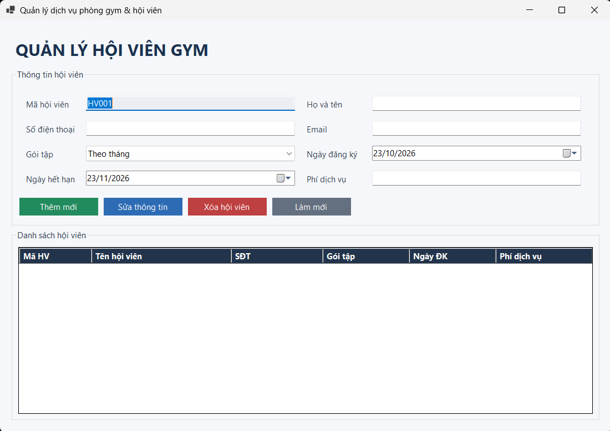

**Kiểm tra dữ liệu không hợp lệ:**

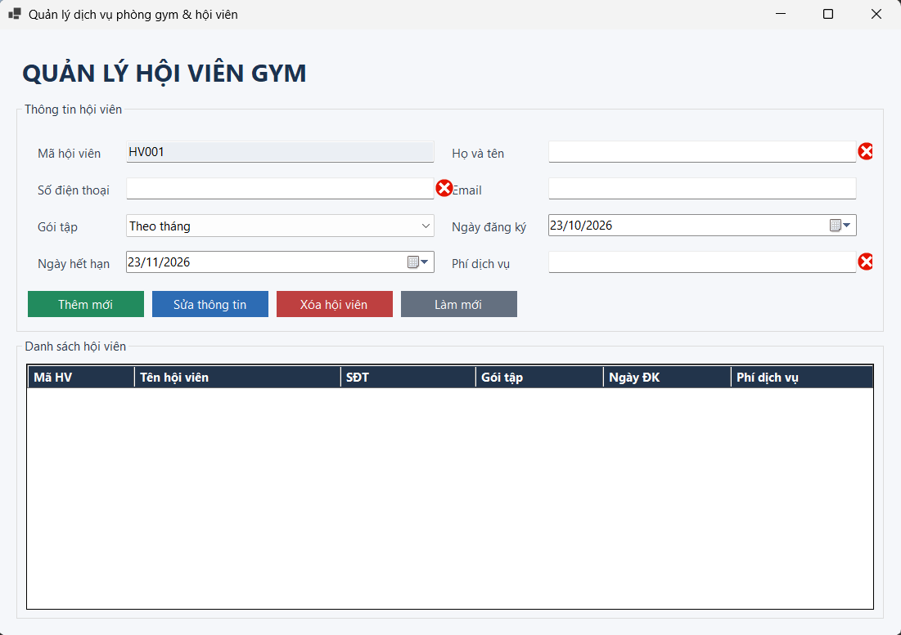

---

### 2. Bài 2: Quản lý và xuất báo cáo nhà sách

**Kỹ thuật áp dụng:**
- OpenFileDialog để chọn ảnh bìa sách.
- Đọc và ghi dữ liệu bằng file CSV.
- Cập nhật trạng thái thao tác bằng StatusStrip.

**Giao diện quản lý sách:**

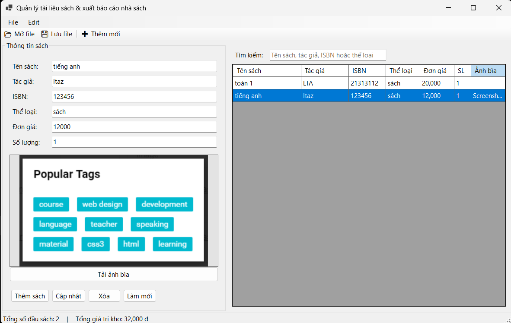

**Minh họa đọc hoặc xuất CSV:**

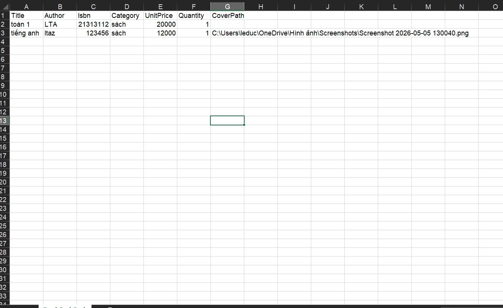

---

### 3. Bài 3: Hệ thống MDI quản lý bệnh viện và Async/Await

**Kỹ thuật áp dụng:**
- MDI Container quản lý các Form con.
- Ngăn mở trùng Form con.
- Sử dụng async/await để xử lý tác vụ bất đồng bộ.
- Sử dụng Invoke khi cần cập nhật giao diện từ luồng khác.

**Giao diện MDI:**

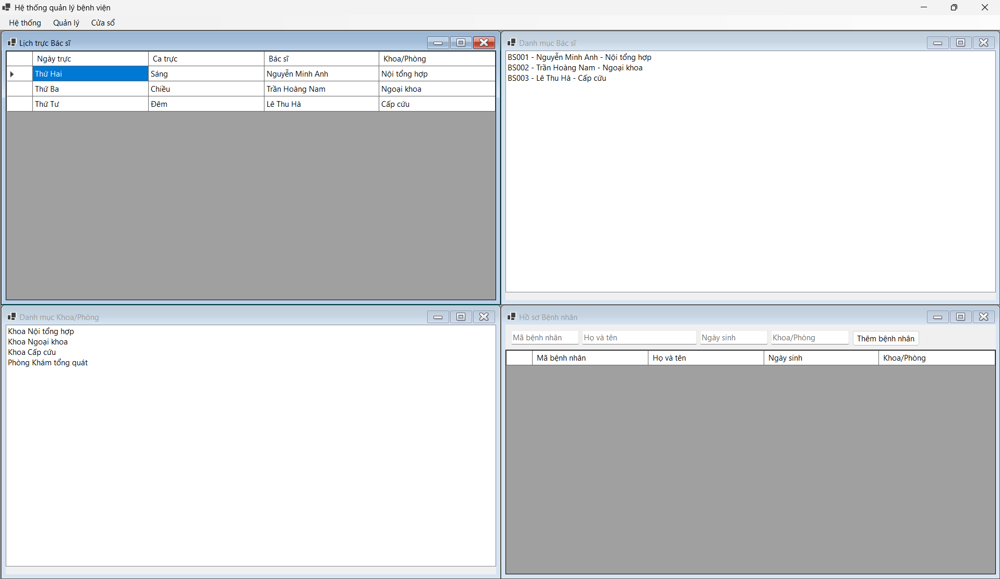

**Minh họa xử lý bất đồng bộ:**

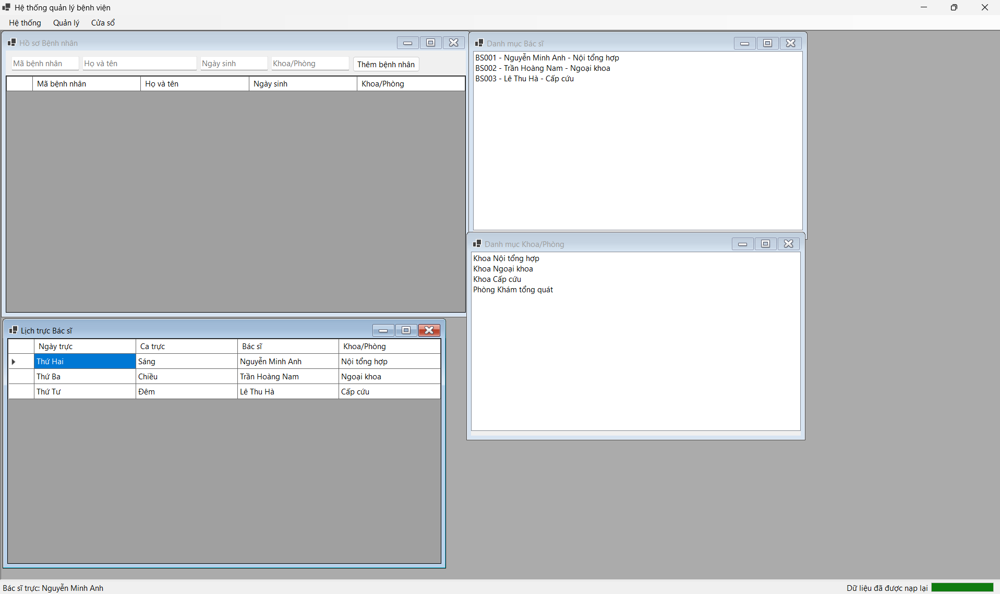

---

### 4. Bài 4: Bảng điều khiển thống kê doanh thu đa luồng

**Kỹ thuật áp dụng:**
- Task.Run kết hợp async/await.
- Giữ giao diện phản hồi trong khi xử lý dữ liệu.
- CancellationTokenSource để hủy tác vụ.
- ProgressBar và Label hiển thị trạng thái xử lý.

**Giao diện thống kê doanh thu:**

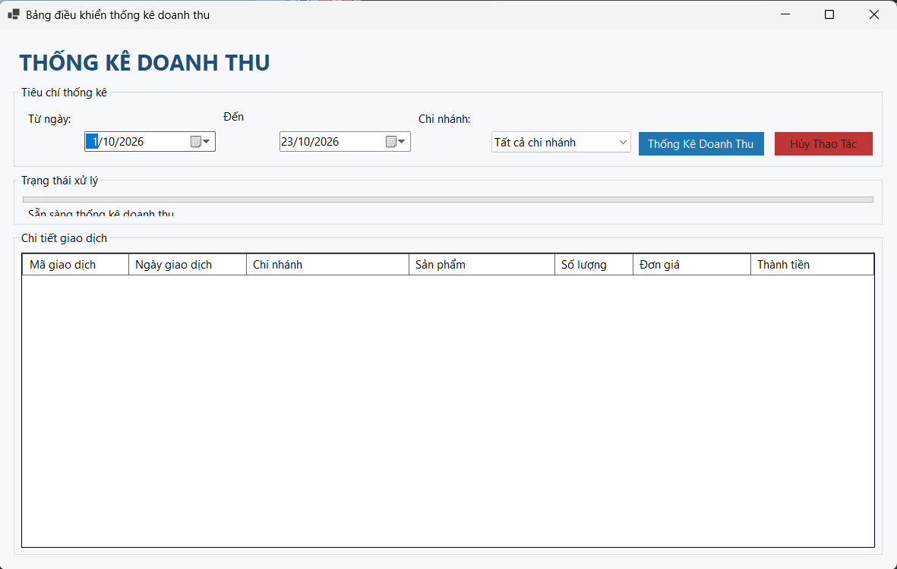

**Minh họa xử lý bất đồng bộ và hủy tác vụ:**

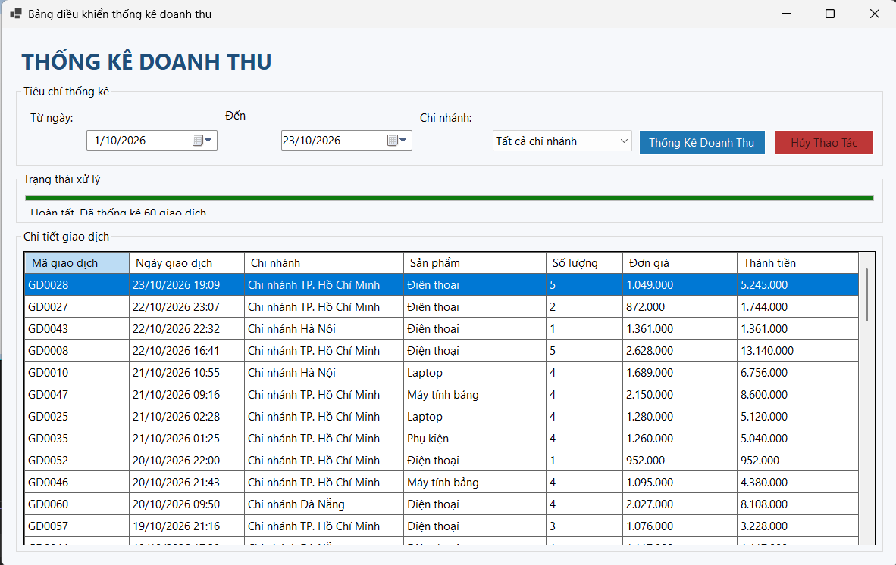
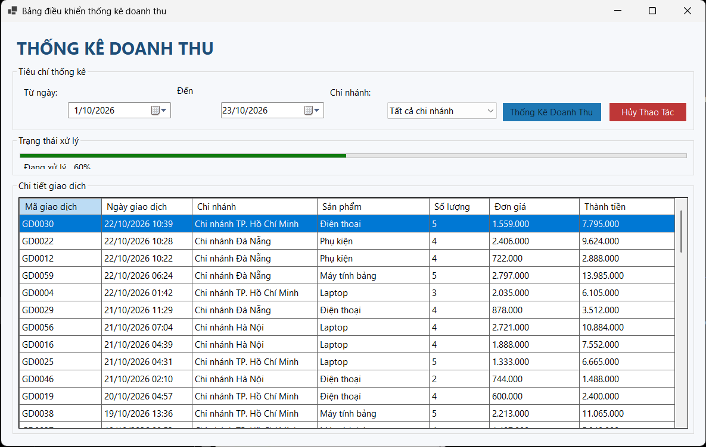
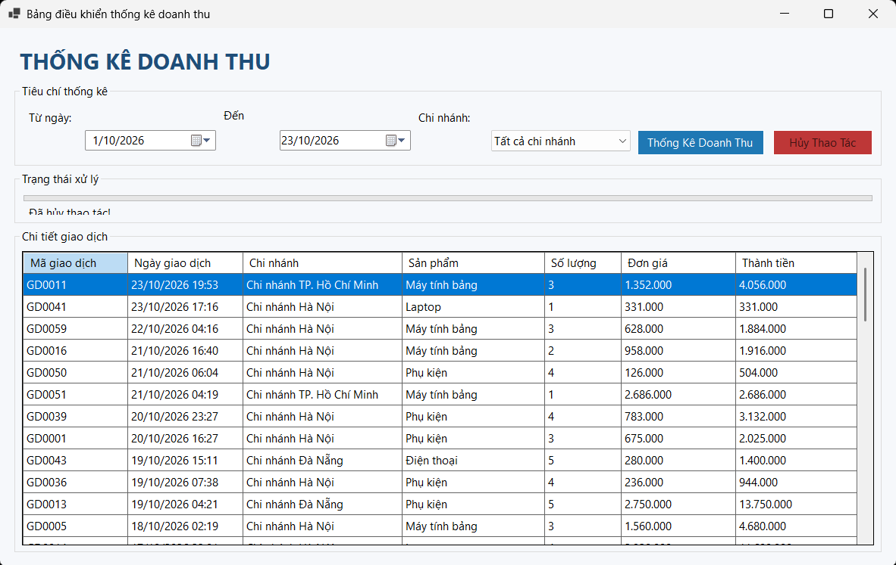

---

### 5. Bài 5: Mô phỏng giám sát tỷ giá tài chính thời gian thực

**Kỹ thuật áp dụng:**
- Task.Run chạy vòng lặp giám sát nền.
- Cập nhật dữ liệu định kỳ mỗi 2 giây.
- Invoke hoặc InvokeRequired bảo đảm an toàn luồng khi cập nhật giao diện.
- Ghi nhật ký biến động giá vào DataGridView.
- Đổi màu giá theo chiều hướng tăng hoặc giảm.

**Giao diện giám sát tỷ giá:**

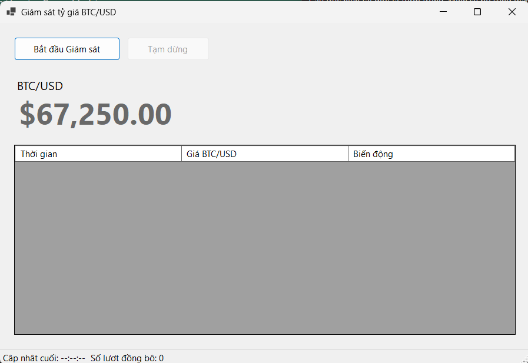

**Lịch sử biến động giá:**

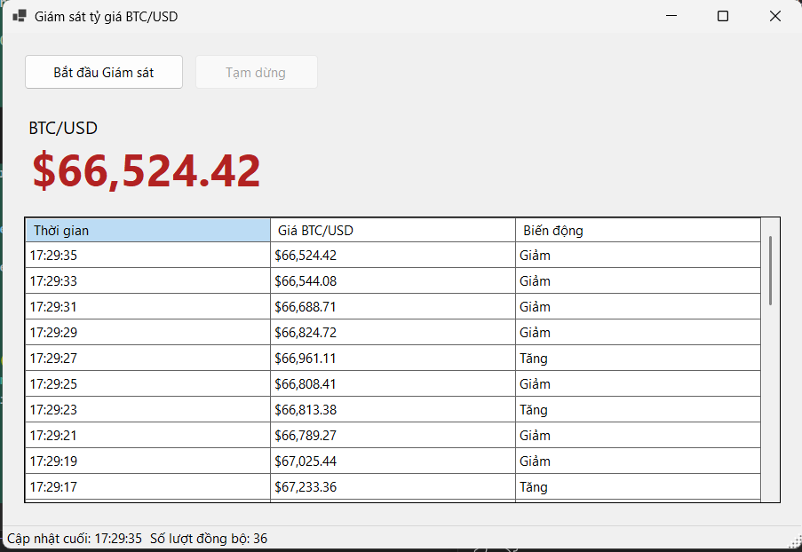

**Minh họa thay đổi màu giá:**

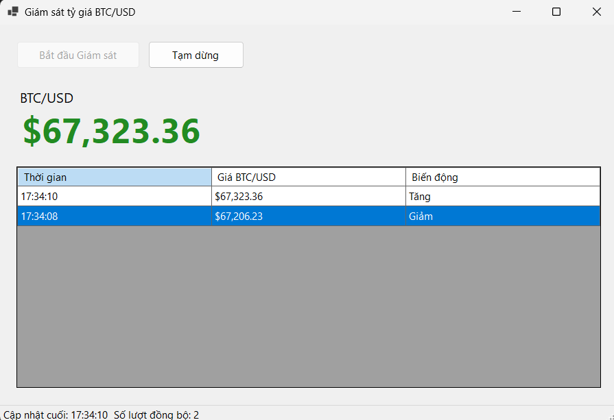

---

## IV. CẤU TRÚC THƯ MỤC DỰ ÁN

```text
LTNET_24810320204_LeTuanAnh/
├── .gitignore
├── README.md
├── screenshots
│   ├── bai1_main.png.png
│   ├── bai1_error.png.png
│   ├── bai2_main.png.png
│   ├── bai2_csv.png.png
│   ├── bai3_mdi.png.png
│   ├── bai3_async.png.png
│   ├── bai4_main.png.png
│   ├── bai4_async_cancel.png.png
│   ├── bai5_main.png.png
│   ├── bai5_history.png.png
│   └── bai5_price_change.png.png
└── src/
    └── WinFormsAppSolution.sln
```

---

## V. HƯỚNG DẪN CÀI ĐẶT VÀ CHẠY DỰ ÁN

### 1. Yêu cầu môi trường

- Windows.
- Visual Studio 2022.
- Workload .NET desktop development.
- .NET SDK phù hợp với phiên bản dự án.

### 2. Các bước thực hiện

**Bước 1:** Clone repository về máy.

```bash
git clone https://github.com/letuananh9206-creator/LTNET_24810320204_LeTuanAnh.git
```

**Bước 2:** Mở file `src/WinFormsAppSolution.sln` bằng Visual Studio 2022.

**Bước 3:** Chọn dự án cần chạy và đặt làm Startup Project nếu Solution có nhiều dự án.

**Bước 4:** Nhấn F5 hoặc chọn Start để biên dịch và chạy chương trình.

---

## VI. KẾT LUẬN

Qua các bài tập thực hành, sinh viên vận dụng kiến thức lập trình C# Windows Forms, quản lý và liên kết dữ liệu, xử lý file, xây dựng giao diện MDI và lập trình bất đồng bộ. Các bài tập giúp rèn luyện kỹ năng kiểm tra dữ liệu đầu vào, xử lý tác vụ nền và cập nhật giao diện an toàn giữa các luồng.

**Sinh viên thực hiện:** Lê Tuấn Anh

**Mã số sinh viên:** 24810320204

**Lớp:** D19QTANM1
